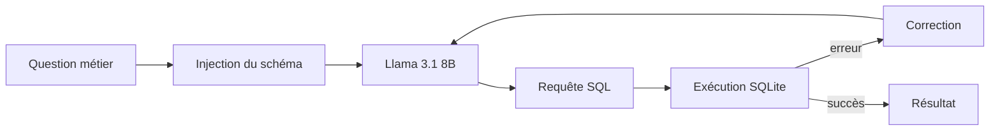

# Agent Text-to-SQL

Agent qui traduit des questions métier en français en requêtes SQL sur une base SQLite, avec injection dynamique du schéma et boucle d'auto-correction. Le projet comprend aussi un benchmark maison et un fine-tuning QLoRA de Llama 3.1 8B, entraîné sur un Mac. *Projet personnel en cours : l'interface reste à faire.*

## Résultat principal

Sur les 100 questions du split de test, utilisé une seule fois après tous les choix :

| Llama 3.1 8B quantifié en 4 bits, 0-shot | SQL valide | EX | EX relâchée |
|---|---|---|---|
| Sans adaptateur | 86 % | 18 % | 27 % |
| **Avec adaptateur QLoRA** | **98 %** | **42 %** | **55 %** |
| *Questions gagnées / perdues, test de McNemar* | *+12/-0, p < 0,001* | *+27/-3, p < 0,001* | *+32/-4, p < 0,001* |

*EX (execution accuracy) : la requête renvoie le même résultat que la référence. Voir [Évaluation](#évaluation).*

Le fine-tuning fait plus que doubler l'EX, mais **le modèle n'est pas fiable seul** : 98 requêtes s'exécutent et 42 seulement sont justes, donc la plupart des erreurs ne produisent aucun message d'erreur. Le gain vient surtout du nombre de colonnes renvoyées, ce qui peut refléter en partie les conventions du benchmark plutôt que de meilleures requêtes (voir [Fine-tuning](#fine-tuning-qlora)).

## Fonctionnement de l'agent



## Limites

**La boucle de correction ne rattrape que les requêtes qui échouent.** Elle se déclenche sur une erreur SQLite, avec 3 tentatives au maximum. Une requête qui s'exécute mais renvoie une mauvaise réponse passe sans relance : sans requête de référence, l'agent n'a aucun moyen de savoir que le résultat est faux.

Sur la validation, avec le modèle servi (GGUF Q4_K_M), 57 questions sur 100 échouent en une seule génération : 6 sur une erreur SQLite, que la boucle peut relancer, et 51 sur une requête valide mais fausse, qu'elle ne voit pas. Le gain était donc plafonné à +6 points. Mesuré sur l'agent complet :

| Validation (100 questions) | Tentative 1 | Agent (3 tentatives max.) |
|---|---|---|
| SQL valide | 94 % | 97 % |
| Execution accuracy | 43 % | **44 %** |
| Latence moyenne | 3,1 s | 4,2 s |

*La tentative 1 reproduit à l'identique les 100 requêtes du run `evaluate.py` du même GGUF : à température 0, llama-server est déterministe, et les deux colonnes se comparent directement.*

**La boucle rattrape 1 question sur 6.** Sur les 6 relancées, 3 deviennent valides, mais une seule devient juste. Les relances ont deux défauts :

- **Le modèle corrige le mauvais côté de l'erreur.** Face à `no such column: count_abos`, il renomme la colonne qu'il appelle (`count_abos`, puis `count`, puis `abo_count`) au lieu d'ajouter le `AS count_abos` qui manque dans la sous-requête. Il n'y a aucune répétition exacte sur les 10 relances, mais la plupart sont des retouches cosmétiques qui reproduisent la même erreur.
- **Une erreur bruyante peut devenir silencieuse.** Pour corriger `AVG(SUM(...))`, que SQLite refuse, le modèle a supprimé le `SUM` : la requête s'exécute, mais elle calcule autre chose. C'est le pire cas, car l'utilisateur ne voit plus d'erreur.

5 des 6 erreurs ont la même structure : un agrégat appliqué à un agrégat calculé par groupe (`AVG(COUNT(...))`, `AVG(SUM(...))`, `MAX` d'une somme mensuelle), ce qui demande une sous-requête ou une CTE avec un alias. Le message de SQLite dit ce qui ne va pas, pas comment restructurer la requête. Des indices ciblés dans le message de correction viseraient ce cas, mais les concevoir sur ces 6 questions puis les mesurer dessus reviendrait à surapprendre la validation.

**Pas de relance sur un résultat vide.** C'est un choix délibéré : « aucun client ne correspond » est souvent la bonne réponse, et une relance pousserait le modèle à inventer un filtre pour renvoyer quelque chose.

**Piste non explorée : la self-consistency.** Elle consiste à générer plusieurs requêtes, les exécuter, puis garder le résultat majoritaire. Elle pourrait attaquer une partie des requêtes valides mais fausses, au prix d'une latence multipliée par le nombre de générations sur chaque question.

## Installation

Le projet demande Python 3.13 et [uv](https://docs.astral.sh/uv/getting-started/installation/), qui installe les versions exactes de `uv.lock` :

```bash
uv sync
```

Les poids de Llama 3.1 sont soumis à une licence : acceptez-la sur la [page du modèle](https://huggingface.co/meta-llama/Llama-3.1-8B-Instruct), puis connectez-vous à Hugging Face :

```bash
uv run hf auth login
```

Les questions du benchmark sont versionnées dans `data/raw/`, mais pas la base SQLite ni le dataset. Pour les générer, exécutez le notebook [`01_generation_bdd.ipynb`](notebooks/01_generation_bdd.ipynb), qui crée `data/raw/banque_entreprise.db`, puis lancez :

```bash
uv run python -m src.finetuning.build_dataset
```

Pour vérifier l'installation :

```bash
uv run pytest
```

## Lancer l'agent avec llama-server

L'agent de production (`src/serving/agent.py`) interroge le modèle fine-tuné, quantifié en GGUF Q4_K_M, via [llama-server](https://github.com/ggml-org/llama.cpp/tree/master/tools/server). Il faut deux terminaux.

Terminal 1, le serveur (depuis la racine du repo) :

```bash
~/tools/llama.cpp/build/bin/llama-server -m models/gguf/llama31-lora-v1-iter440-Q4_K_M.gguf \
    -ngl 99 -c 4096 --port 8080 --chat-template-kwargs '{"date_string": "26 Jul 2024"}'
```

- `-ngl 99` : toutes les couches sur le GPU (Metal sur Mac).
- `-c 4096` : contexte assez large pour le schéma de la base, inclus dans chaque prompt.
- `--chat-template-kwargs` : **obligatoire**. Le template de Llama 3.1 écrit une ligne `Today Date:` dans le prompt système. HF y laisse `26 Jul 2024`, la date vue à l'entraînement et à l'évaluation, alors que llama-server y met la date du jour. Sans cette option, le prompt diffère de celui qui a été mesuré, sans qu'aucune erreur ne le signale (détecté par `tests/test_llm_server_integration.py`).

Terminal 2, une fois `listening on http://127.0.0.1:8080` affiché :

```bash
uv run python -m src.serving.agent "Quel est le solde moyen des comptes courants ?"
```

Options : `--url` (défaut : la variable d'environnement `LLAMA_SERVER_URL`, sinon `http://localhost:8080`), `--max-tentatives` (défaut 3), `--max-lignes` (défaut 20).

## Lancer l'agent avec Docker

L'agent est empaqueté dans une image Docker (`Dockerfile`, environ 350 Mo) qui ne contient que Python 3.13 et les dépendances de l'agent, sans torch ni MLX. Le modèle peut tourner à deux endroits :

| Mode | llama-server | Fichiers Compose | Usage |
|---|---|---|---|
| Hybride | natif sur l'hôte, GPU Metal | `compose.yaml` | sur un Mac, pour la vitesse du GPU |
| CPU | en conteneur, image officielle | `compose.yaml` + `compose.cpu.yaml` | sur toute machine avec Docker, sans GPU |

Docker ne donne pas accès au GPU Metal du Mac : un llama-server en conteneur tourne donc sur CPU, d'où le mode hybride.

Prérequis : Docker ([Docker Desktop](https://docs.docker.com/desktop/) sur Mac), la base `data/raw/banque_entreprise.db` (voir [Installation](#installation)) et le GGUF dans `models/gguf/`. La base et les poids ne sont pas copiés dans les images : ils sont montés en lecture seule au lancement.

### Mode hybride

Lancez llama-server comme dans la section précédente, puis :

```bash
docker compose run --rm agent "Quel est le solde moyen des comptes courants ?"
```

Dans un conteneur, `localhost` désigne le conteneur lui-même : l'agent joint le serveur de l'hôte via `host.docker.internal`. Sous Docker Desktop, un llama-server qui n'écoute que sur `127.0.0.1` reste joignable de cette façon. Sous Linux (non testé), `host.docker.internal` pointe vers l'interface du réseau Docker, et non vers `127.0.0.1` : llama-server doit alors écouter sur cette interface.

### Mode CPU

```bash
docker compose -f compose.yaml -f compose.cpu.yaml run --rm agent "Quel est le solde moyen des comptes courants ?"

# --rm ne supprime que le conteneur de l'agent : llama-server continue de tourner (~5 Go de RAM)
docker compose -f compose.yaml -f compose.cpu.yaml down
```

`compose.cpu.yaml` complète `compose.yaml` : il ajoute un service llama-server et fait pointer l'agent vers lui. L'agent ne démarre qu'une fois le modèle chargé, grâce au healthcheck sur `/health`. La date du template est fixée comme en natif.

L'image de llama-server est épinglée sur le build `server-b12110`, qui correspond au même commit que la version native (v0.9.0). Sur les 3 premières questions de validation, l'agent produit les mêmes requêtes qu'en mode Metal. Ce n'est pas garanti en général : le CPU et le GPU n'arrondissent pas les calculs de la même façon, et à température 0 un écart minime peut changer un token.

### Latence

Ordres de grandeur mesurés sur un Mac M5 (10 cœurs alloués à Docker) avec 3 questions de validation, en comptant toute la commande, création du conteneur comprise :

| | Natif (Metal) | Hybride | CPU |
|---|---|---|---|
| Lecture du prompt | 449 tokens/s | 449 tokens/s | 60 tokens/s |
| Génération | 26 tokens/s | 26 tokens/s | 18 tokens/s |
| 1re question après démarrage | ~1,8 s | ~6 s | 15,5 s |
| Questions suivantes | ~1,8 s | ~2,3 s | 3,4 à 3,8 s |

Sur CPU, le coût vient surtout de la lecture du prompt. Chaque prompt compte environ 700 tokens, dont le schéma de la base, et la première lecture prend 12 s. llama-server garde ensuite en cache le calcul du début commun à toutes les questions (prompt système et schéma) et ne lit plus que la vingtaine de tokens de la question. Cela ne marche que parce que la question est placée à la fin du prompt : le cache s'arrête au premier token qui diffère.

### Notes de déploiement

- **Serveur x86** : une image construite sur un Mac Apple Silicon est en arm64. Pour un serveur x86, construisez avec `docker build --platform linux/amd64 -t text2sql-agent .`. L'image llama-server existe pour les deux architectures.
- **Sécurité** : llama-server n'a ni clé API ni restriction CORS. En mode hybride, il n'écoute que sur `127.0.0.1`. En mode CPU, son port n'est pas publié sur l'hôte : seul l'agent le joint, par le réseau interne de Compose. Pour l'exposer, il faudrait au minimum `--api-key`.
- **Amélioration possible** : un build en plusieurs étapes (multi-stage) allégerait l'image de l'agent en laissant uv et les fichiers de build hors de l'image finale.

## Évaluation

Benchmark maison de 691 questions métier en français, chacune associée à une requête SQL de référence et répartie dans 12 familles (filtres, jointures, `GROUP BY` / `HAVING`, dates, top-N par groupe, ratios…) :

| Split | Questions | Rôle |
|---|---|---|
| Train | 491 | exemples few-shot ; 441 pour l'entraînement du LoRA et 50 de dev pour suivre sa perte |
| Validation | 100 | comparaison des prompts et des configurations |
| Test | 100 | évaluation finale, utilisée une seule fois |

**Métriques**

- **SQL valide** : la requête générée s'exécute sans erreur.
- **Execution accuracy (EX)**, métrique principale : la requête générée renvoie le même résultat que la référence. Les colonnes sont comparées à permutation près (convention de l'évaluateur [Spider test-suite](https://github.com/taoyds/test-suite-sql-eval)), et l'ordre des lignes ne compte que si la référence a un `ORDER BY`.
- **EX relâchée**, métrique secondaire : accepte aussi une requête qui renvoie la bonne réponse avec des colonnes en plus. Utile pour distinguer « mauvaise réponse » et « bonne réponse avec des colonnes en trop », mais gonflée par les `SELECT *` : elle ne sert pas à comparer deux prompts qui changent la façon de sélectionner les colonnes.

Les sorties brutes du modèle, les requêtes et les scores par question sont enregistrés dans `results/`, avec les versions du prompt et de la métrique.

### Prompt

Llama 3.1 8B Instruct en 16 bits (transformers), 0-shot, validation.

| Prompt | SQL valide | EX | EX relâchée |
|---|---|---|---|
| v1 : schéma seul | 87 % | 16 % | 34 % |
| v2 : + valeurs des colonnes catégorielles + règles SQLite | 90 % | 19 % | 25 % |

Chaque règle du prompt v2 vise une erreur observée sur la v1, et chacune a réduit son erreur cible : `SELECT *` passe de 27 à 10 requêtes, `EXTRACT` (absent de SQLite) et les valeurs mal casées (`'payée'` au lieu de `'Payée'`) disparaissent. Le gain d'EX (+3 points sur 100 questions) reste dans la marge de bruit. La baisse de l'EX relâchée s'explique par la disparition des `SELECT *` et par un modèle devenu trop minimaliste dans le choix des colonnes.

### Few-shot

Modèle 16 bits, prompt v2, 5 exemples tirés du train, validation.

Sur 3 graines, l'EX passe de 19 % en 0-shot à 33 %, 33 % et 41 %, soit **35,7 % ± 4,6** en moyenne. La graine 2 n'est pas retenue comme « la meilleure » : la choisir sur la validation serait du sur-ajustement, et son écart avec la graine 1 n'est pas significatif (+13/-5, p = 0,10).

### Ablation : d'où vient l'écart entre les jeux d'exemples ?

Une **ablation** consiste à ne faire varier qu'un élément d'un système, tout le reste étant fixe, pour isoler ce qu'il apporte. Ici, le jeu s2 (41 %) devance le jeu s1 (33 %), et ses exemples sélectionnent plus de colonnes (3,0 contre 2,0 en moyenne). Deux explications se confondent : les questions des exemples, ou le style de leurs colonnes.

Le plan 2×2 les sépare. Chaque jeu garde ses 5 questions et le corps de ses requêtes, et seule la liste du `SELECT` change (exemples dans [`data/shots/`](data/shots/), contrôlés par `tests/test_shots.py`) :

- **Minimal** : uniquement les colonnes nécessaires pour répondre à la question.
- **Riche** : identifiant + libellé + mesure, parmi ce que permettent les tables de la requête.

Les exemples, la métrique principale et les 4 comparaisons ont été figés avant de voir les scores. La prédiction était que le score suivrait le style et non les questions.

| EX | Minimal | Riche | Effet du style |
|---|---|---|---|
| **Questions s1** | 24 % | 29 % | +9/-4, p = 0,53 |
| **Questions s2** | 23 % | 41 % | **+21/-3, p = 0,001** |
| **Effet des questions** | +2/-3, p = 1 | **+13/-1, p = 0,006** | |

*+x/-y : questions gagnées et perdues par le second run de la paire. Test de [McNemar](https://en.wikipedia.org/wiki/McNemar%27s_test) exact, adapté à des runs évalués sur les mêmes questions, avec [correction de Holm](https://en.wikipedia.org/wiki/Holm%E2%80%93Bonferroni_method) sur les 4 comparaisons.*

**La prédiction n'est pas confirmée.** Le style et les questions interagissent : en minimal, les deux jeux se valent, mais seul le style riche du jeu s2 progresse nettement. Sur le jeu s1, l'effet du style reste indéterminé, car 13 questions qui basculent ne suffisent pas à conclure.

**Piste exploratoire**, choisie après avoir vu les scores : une réponse ne peut être juste que si elle a autant de colonnes que la référence. Or, parmi ces réponses, le taux de réussite reste stable dans tous les runs de cette ablation, y compris en 0-shot (64 à 70 %). L'écart viendrait donc surtout du fait de tomber sur le bon nombre de colonnes : `s1_riche` et `s2_riche` renvoient en moyenne 2,4 colonnes, mais le premier a le bon nombre sur 45 questions et le second sur 62.

**Limites** : 100 questions seulement, toutes issues de la validation, et un seul jeu de 5 questions par condition. Les colonnes attendues par les références sont en partie arbitraires : un gain peut refléter une meilleure imitation des conventions du benchmark plutôt que de meilleures requêtes.

### Fine-tuning QLoRA

Le **QLoRA** gèle un modèle quantifié et n'entraîne que de petites matrices ajoutées à certaines couches : ici 0,13 % des paramètres, soit un adaptateur de 42 Mo. L'entraînement tourne sur un Mac Apple M5 de 24 Go avec [mlx-lm](https://github.com/ml-explore/mlx-lm).

**Modèle de départ.** Le passage du modèle 16 bits au 4 bits ne dégrade pas le score de façon détectable (EX 19 % → 17 %, +2/-4, p = 0,69). La référence du fine-tuning est donc le modèle 4 bits, sur le même moteur : 17 %, et non les scores obtenus en 16 bits.

**Entraînement.** Rang 8, 16 couches, learning rate 1e-5, batch de 2 (le batch de 4 dépasse la mémoire disponible). Le prompt représente environ 93 % des tokens et varie très peu : la perte est donc masquée pour ne porter que sur la réponse SQL (`--mask-prompt`).

La perte de dev passe de 1,071 à 0,067 et plafonne dès la première époque. L'itération 440 (2 époques) est retenue sur ce dev, et c'est le seul point évalué : comparer plusieurs points sur la validation aurait biaisé la comparaison. Cette perte ne prédit pas directement l'EX, car elle récompense aussi une mise en forme sans effet sur le résultat, comme les sauts de ligne : le modèle de base en met dans 6 % de ses réponses, le LoRA dans 100 %.

**Fine-tuning × few-shot** (EX, validation)

| Modèle 4 bits | 0-shot | Graine 42 | Graine 1 | Graine 2 | Moyenne 5-shot |
|---|---|---|---|---|---|
| **Sans adaptateur** | 17 % | 38 % (+22/-1) | 30 % (+14/-1) | 42 % (+26/-1) | 36,7 % ± 6,1 |
| **Avec adaptateur** | **40 %** | 41 % (+14/-13) | 41 % (+11/-10) | 37 % (+10/-13) | 39,7 % ± 2,3 |

*Chaque 5-shot est comparé au 0-shot du même modèle : McNemar exact, correction de Holm sur les 6 comparaisons. Les 3 gains sans adaptateur sont significatifs (p ≤ 0,004), aucun des 3 avec adaptateur (p = 1).*

La prédiction et la règle de décision ont été figées avant les scores : le few-shot devait aider le modèle de base mais apporter moins au LoRA, et le 5-shot n'était retenu que s'il dépassait nettement le 0-shot. **La prédiction est confirmée, et le LoRA 0-shot est la configuration envoyée au test.** Sur le LoRA, les shots changent le résultat de 21 à 27 questions selon la graine, mais gains et pertes s'annulent.

**D'où vient le gain** (analyse exploratoire, validation)

| | Sans adaptateur | Avec adaptateur |
|---|---|---|
| Réponses avec le bon nombre de colonnes | 29 | 66 |
| Justes parmi ces réponses | 59 % | 61 % |

Le gain vient surtout du choix des colonnes : à bon nombre de colonnes, le taux de réussite ne monte presque pas. Le test montre la même tendance (27 → 70 réponses, 67 % → 60 %). La logique SQL progresse parfois aussi, par exemple sur un `GROUP BY` que le modèle de base oubliait.

**Limites**

- Le test ne compte que 100 questions, et le score par famille n'y repose que sur 7 à 9 questions.
- Le benchmark est maison, et les colonnes attendues sont en partie arbitraires : l'EX ne dit pas à elle seule si le modèle raisonne mieux en SQL.
- Le modèle fine-tuné n'a pas été évalué avec la boucle de correction de l'agent.
- Le split de test étant consommé, tout nouveau modèle demandera un nouveau jeu de test.

### Reproduire

Lancer un benchmark :

```bash
uv run python -m src.text2sql.evaluate --split validation --shots 0 --name mon_run
```

Évaluer l'agent complet, boucle de correction comprise (llama-server lancé, voir [Lancer l'agent](#lancer-lagent-avec-llama-server)) :

```bash
uv run python -m src.serving.evaluate_agent --split validation --name mon_run
```

Rejouer un run de l'ablation, puis recalculer l'analyse à partir de `results/` :

```bash
uv run python -m src.text2sql.evaluate --split validation --shots-file data/shots/s2_riche.json --name mon_run
uv run python -m src.text2sql.analyse_ablation
```

Refaire le fine-tuning (Apple Silicon requis, environ 80 min pour les 660 itérations) :

```bash
# Quantifier le modèle, puis exporter le train au format de mlx-lm
uv run mlx_lm.convert --hf-path meta-llama/Llama-3.1-8B-Instruct --mlx-path models/llama31-8b-4bit -q --q-bits 4
uv run python -m src.finetuning.export_mlx

# Entraîner
uv run mlx_lm.lora --train \
  --model models/llama31-8b-4bit \
  --data data/processed/mlx \
  --mask-prompt \
  --batch-size 2 \
  --iters 660 \
  --steps-per-report 10 --steps-per-eval 110 --save-every 110 --val-batches -1 \
  --seed 42 \
  --adapter-path models/adapters/llama31-4bit-lora-v1

# mlx-lm charge toujours « adapters.safetensors » : l'itération 440 a donc son propre dossier
A=models/adapters/llama31-4bit-lora-v1
mkdir -p $A-iter440
cp $A/adapter_config.json $A-iter440/
cp $A/0000440_adapters.safetensors $A-iter440/adapters.safetensors

# Évaluer
uv run python -m src.text2sql.evaluate --backend mlx \
  --model models/llama31-8b-4bit \
  --adapter $A-iter440 \
  --split validation --name mon_run
```

Recalculer les chiffres du fine-tuning et du test à partir de `results/`, sans relancer de modèle :

```bash
uv run python -m src.text2sql.analyse_finetuning
```

## Avancement

- [x] Injection dynamique du schéma
- [x] Évaluation (execution accuracy, benchmark de 691 questions)
- [x] Prompt few-shot et ablation sur le style des colonnes
- [x] Fine-tuning QLoRA
- [x] Agent LangGraph avec boucle de correction, sur le modèle fine-tuné servi par llama.cpp
- [x] Évaluation de l'agent complet
- [x] Mise en production (llama.cpp, Docker)
- [ ] Interface

## Stack

Python · Llama 3.1 8B · MLX (mlx-lm) · llama.cpp · LangGraph · SQLite · uv · Docker
