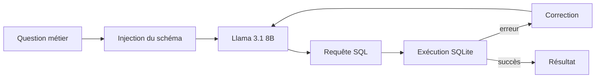

# Agent Text-to-SQL

Agent qui traduit des questions en langage métier en requêtes SQL, avec injection dynamique du schéma et boucle d'auto-correction sur les erreurs SQL. *Projet personnel en cours.*

## Fonctionnement



## Exemple

**Question :** « Quels sont les 3 clients avec les plus gros montants d'abonnements au sein de chaque région ? »

**Requête SQL générée :**

```sql
WITH Ranked AS (
    SELECT T3.region, T1.client_id,
           SUM(T1.prix_mensuel) AS total_abonnement,
           ROW_NUMBER() OVER (PARTITION BY T3.region
                              ORDER BY SUM(T1.prix_mensuel) DESC) AS rn
    FROM abonnements T1
    JOIN clients T2 ON T1.client_id = T2.client_id
    JOIN clients T3 ON T1.client_id = T3.client_id
    GROUP BY T3.region, T1.client_id
)
SELECT T2.nom_entreprise, T3.region, T1.total_abonnement
FROM Ranked T1
JOIN clients T2 ON T1.client_id = T2.client_id
JOIN clients T3 ON T1.client_id = T3.client_id
WHERE T1.rn <= 3;
```

**Résultat (extrait) :**

| Région | Client | Montant d'abonnement |
|---|---|---|
| Alsace | Collet S.A.R.L. | 537,79 € |
| Alsace | Hoareau | 500,67 € |
| Alsace | Rodriguez | 494,51 € |
| Aquitaine | Brunel Lenoir SARL | 593,80 € |
| Aquitaine | Jacob Aubry S.A. | 544,04 € |
| Aquitaine | Dubois SARL | 503,70 € |

*Base de démonstration avec des données fictives.*

## Exemple d'auto-correction

**Tentative 1** : l'agent génère une requête qui échoue :

```sql
WITH Ranked AS (
    SELECT region, client_id,
           SUM(prix_mensuel) AS total_abonnement,
           ROW_NUMBER() OVER (PARTITION BY region
                              ORDER BY SUM(prix_mensuel) DESC) AS rn
    FROM abonnements
    GROUP BY region, client_id
)
SELECT nom_entreprise, region, total_abonnement
FROM Ranked
JOIN clients ON Ranked.client_id = clients.client_id
WHERE rn <= 3;
```

**Erreur SQLite renvoyée à l'agent :**

```
sqlite3.OperationalError: no such column: region
```

**Tentative 2** : la colonne `region` appartient à la table `clients`, pas à `abonnements`. L'agent corrige en ajoutant la jointure nécessaire, et la requête s'exécute avec succès (voir la requête de l'exemple ci-dessus).

## Évaluation

Benchmark maison de questions métier en français, chacune associée à une requête SQL de référence : 491 exemples d'entraînement, 100 de validation et 100 de test, répartis en 12 familles (filtres, jointures, `GROUP BY` / `HAVING`, dates, top-N par groupe, ratios…). Le split test est réservé à l'évaluation finale.

**Métriques**

- **SQL valide** : la requête générée s'exécute sans erreur.
- **Execution accuracy (EX)**, métrique principale : la requête générée renvoie le même résultat que la référence. Les colonnes sont comparées à permutation près (convention de l'évaluateur [Spider test-suite](https://github.com/taoyds/test-suite-sql-eval)), et l'ordre des lignes ne compte que si la référence a un `ORDER BY`.
- **EX relâchée**, métrique secondaire : accepte aussi une requête qui renvoie la bonne réponse avec des colonnes en plus. Utile pour distinguer « mauvaise réponse » et « bonne réponse avec des colonnes en trop », mais gonflée par les `SELECT *` : elle ne sert pas à comparer deux prompts qui changent la façon de sélectionner les colonnes.

**Résultats** (Llama 3.1 8B Instruct, 0-shot, validation)

| Prompt | SQL valide | EX | EX relâchée |
|---|---|---|---|
| v1 : schéma seul | 87 % | 16 % | 34 % |
| v2 : + valeurs des colonnes catégorielles + règles SQLite | 90 % | 19 % | 25 % |

Chaque règle du prompt v2 vise une erreur observée sur la v1, et chacune a réduit son erreur cible : `SELECT *` passe de 27 à 10 requêtes, `EXTRACT` (absent de SQLite) et les valeurs mal casées (`'payée'` au lieu de `'Payée'`) disparaissent. Le gain d'EX (+3 points sur 100 questions) reste dans la marge de bruit. La baisse de l'EX relâchée s'explique par la disparition des `SELECT *` et par un modèle devenu trop minimaliste dans le choix des colonnes : c'est la cible de l'étape suivante, le few-shot.

**Few-shot** (prompt v2, 5 exemples tirés du train, validation)

Sur 3 graines, l'EX passe de 19 % en 0-shot à 33 %, 33 % et 41 %, soit **35,7 % ± 4,6** en moyenne. La graine 2 n'est pas retenue comme « la meilleure » : la choisir sur la validation serait du sur-ajustement, et son écart avec la graine 1 n'est pas significatif (+13/-5, p = 0,10).

### Ablation : d'où vient l'écart entre les jeux d'exemples ?

Une **ablation** consiste à ne faire varier qu'un élément d'un système, tout le reste étant fixe, pour isoler ce qu'il apporte. Ici, le jeu s2 (41 %) devance le jeu s1 (33 %), et ses exemples sélectionnent plus de colonnes (3,0 contre 2,0 en moyenne). Deux explications se confondent : les questions des exemples, ou le style de leurs colonnes.

Le plan 2×2 les sépare. Chaque jeu garde ses 5 questions et le corps de ses requêtes, et seule la liste du `SELECT` change (exemples dans [`data/shots/`](data/shots/), contrôlés par `tests/test_shots.py`) :

- **Minimal** : uniquement les colonnes nécessaires pour répondre à la question.
- **Riche** : identifiant + libellé + mesure, parmi ce que permettent les tables de la requête.

Les exemples, la métrique principale et les 4 comparaisons ont été figés avant de voir les scores. La prédiction était que le score suivrait le style et non les questions.

| EX | Minimal | Riche | Effet du style |
|---|---|---|---|
| **Questions s1** | 24 % | 29 % | +9/-4, p = 0,53 |
| **Questions s2** | 23 % | 41 % | **+21/-3, p = 0,001** |
| **Effet des questions** | +2/-3, p = 1 | **+13/-1, p = 0,006** | |

*+x/-y : questions gagnées et perdues par le second run de la paire. Test de [McNemar](https://en.wikipedia.org/wiki/McNemar%27s_test) exact, adapté à des runs évalués sur les mêmes questions, avec [correction de Holm](https://en.wikipedia.org/wiki/Holm%E2%80%93Bonferroni_method) sur les 4 comparaisons.*

**La prédiction n'est pas confirmée.** Le style et les questions interagissent : en minimal, les deux jeux se valent, mais seul le style riche du jeu s2 progresse nettement. Sur le jeu s1, l'effet du style reste indéterminé, car 13 questions qui basculent ne suffisent pas à conclure.

**Piste exploratoire**, choisie après avoir vu les scores et donc à tester sur d'autres données : une réponse ne peut être juste que si elle a autant de colonnes que la référence. Or, parmi ces réponses, le taux de réussite reste stable dans tous les runs, y compris en 0-shot (64 à 70 %). L'écart viendrait donc surtout du fait de tomber sur le bon nombre de colonnes : `s1_riche` et `s2_riche` renvoient en moyenne 2,4 colonnes, mais le premier a le bon nombre sur 45 questions et le second sur 62.

**Limites** : 100 questions seulement, toutes issues de la validation, et un seul jeu de 5 questions par condition. Les colonnes attendues par les références sont en partie arbitraires : un gain peut refléter une meilleure imitation des conventions du benchmark plutôt que de meilleures requêtes.

Lancer un benchmark :

```bash
poetry run python -m src.text2sql.evaluate --split validation --shots 0 --name mon_run
```

Rejouer un run de l'ablation, puis recalculer l'analyse à partir de `results/` :

```bash
poetry run python -m src.text2sql.evaluate --split validation --shots-file data/shots/s2_riche.json --name mon_run
poetry run python -m src.text2sql.analyse_ablation
```

Les sorties brutes du modèle, les requêtes et les scores par question sont enregistrés dans `results/`, avec les versions du prompt et de la métrique.

## Avancement

- [x] Agent LangChain/LCEL (Llama 3.1 8B)
- [x] Injection dynamique du schéma
- [x] Boucle d'auto-correction
- [x] Évaluation (execution accuracy, benchmark de 691 questions)
- [x] Prompt few-shot et ablation sur le style des colonnes
- [ ] Fine-tuning QLoRA
- [ ] Serving vLLM et suivi des performances


## Stack

Python · Llama 3.1 8B · LangChain (LCEL) · SQLite · Poetry