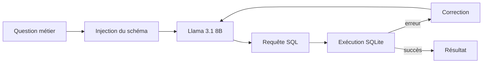

# Agent Text-to-SQL

Agent qui traduit des questions métier en français en requêtes SQL sur une base SQLite, avec injection dynamique du schéma et boucle d'auto-correction. Le projet comprend aussi un benchmark maison et un fine-tuning QLoRA de Llama 3.1 8B, entraîné sur un Mac. *Projet personnel en cours : la mise en production reste à faire.*

## Résultat principal

Sur les 100 questions du split de test, utilisé une seule fois après tous les choix :

| Llama 3.1 8B quantifié en 4 bits, 0-shot | SQL valide | EX | EX relâchée |
|---|---|---|---|
| Sans adaptateur | 86 % | 18 % | 27 % |
| **Avec adaptateur QLoRA** | **98 %** | **42 %** | **55 %** |
| *Questions gagnées / perdues, test de McNemar* | *+12/-0, p < 0,001* | *+27/-3, p < 0,001* | *+32/-4, p < 0,001* |

*EX (execution accuracy) : la requête renvoie le même résultat que la référence. Voir [Évaluation](#évaluation).*

Le fine-tuning fait plus que doubler l'EX, mais **le modèle n'est pas fiable seul** : 98 requêtes s'exécutent et 42 seulement sont justes, donc la plupart des erreurs ne produisent aucun message d'erreur. Le gain vient surtout du nombre de colonnes renvoyées, ce qui peut refléter en partie les conventions du benchmark plutôt que de meilleures requêtes (voir [Fine-tuning](#fine-tuning-qlora)).

## Fonctionnement de l'agent



**L'agent et le benchmark sont pour l'instant séparés.** L'agent utilise encore le modèle de base 16 bits, sans l'adaptateur. Le benchmark mesure une seule génération, sans boucle de correction : les scores ci-dessus ne décrivent donc pas l'agent complet.

## Exemple

Exemple produit par l'agent avec le modèle de base.

**Question :** « Quels sont les 3 clients avec les plus gros montants d'abonnements au sein de chaque région ? »

**Requête SQL générée :**

```sql
WITH Ranked AS (
    SELECT T3.region, T1.client_id,
           SUM(T1.prix_mensuel) AS total_abonnement,
           ROW_NUMBER() OVER (PARTITION BY T3.region
                              ORDER BY SUM(T1.prix_mensuel) DESC) AS rn
    FROM abonnements T1
    JOIN clients T2 ON T1.client_id = T2.client_id
    JOIN clients T3 ON T1.client_id = T3.client_id
    GROUP BY T3.region, T1.client_id
)
SELECT T2.nom_entreprise, T3.region, T1.total_abonnement
FROM Ranked T1
JOIN clients T2 ON T1.client_id = T2.client_id
JOIN clients T3 ON T1.client_id = T3.client_id
WHERE T1.rn <= 3;
```

**Résultat (extrait) :**

| Région | Client | Montant d'abonnement |
|---|---|---|
| Alsace | Fabre | 552,20 € |
| Alsace | Martin | 551,47 € |
| Alsace | Joly | 493,31 € |
| Aquitaine | Le Goff SARL | 581,67 € |
| Aquitaine | Wagner | 526,41 € |
| Aquitaine | Bailly S.A. | 508,53 € |

*Base de démonstration avec des données fictives.*

## Exemple d'auto-correction

**Tentative 1** : l'agent génère une requête qui échoue :

```sql
WITH Ranked AS (
    SELECT region, client_id,
           SUM(prix_mensuel) AS total_abonnement,
           ROW_NUMBER() OVER (PARTITION BY region
                              ORDER BY SUM(prix_mensuel) DESC) AS rn
    FROM abonnements
    GROUP BY region, client_id
)
SELECT nom_entreprise, region, total_abonnement
FROM Ranked
JOIN clients ON Ranked.client_id = clients.client_id
WHERE rn <= 3;
```

**Erreur SQLite renvoyée à l'agent :**

```
sqlite3.OperationalError: no such column: region
```

**Tentative 2** : la colonne `region` appartient à la table `clients`, pas à `abonnements`. L'agent corrige en ajoutant la jointure nécessaire, et la requête s'exécute avec succès (voir la requête de l'exemple ci-dessus).

## Installation

Le projet demande Python 3.13 et [uv](https://docs.astral.sh/uv/getting-started/installation/), qui installe les versions exactes de `uv.lock` :

```bash
uv sync
```

Les poids de Llama 3.1 sont soumis à une licence : acceptez-la sur la [page du modèle](https://huggingface.co/meta-llama/Llama-3.1-8B-Instruct), puis connectez-vous à Hugging Face :

```bash
uv run hf auth login
```

Les questions du benchmark sont versionnées dans `data/raw/`, mais pas la base SQLite ni le dataset. Pour les générer, exécutez le notebook [`01_generation_bdd.ipynb`](notebooks/01_generation_bdd.ipynb), qui crée `data/raw/banque_entreprise.db`, puis lancez :

```bash
uv run python -m src.finetuning.build_dataset
```

Pour vérifier l'installation :

```bash
uv run pytest
```

Pour lancer l'agent sur sa question d'exemple :

```bash
uv run python src/text2sql/agent.py
```

## Évaluation

Benchmark maison de 691 questions métier en français, chacune associée à une requête SQL de référence et répartie dans 12 familles (filtres, jointures, `GROUP BY` / `HAVING`, dates, top-N par groupe, ratios…) :

| Split | Questions | Rôle |
|---|---|---|
| Train | 491 | exemples few-shot ; 441 pour l'entraînement du LoRA et 50 de dev pour suivre sa perte |
| Validation | 100 | comparaison des prompts et des configurations |
| Test | 100 | évaluation finale, utilisée une seule fois |

**Métriques**

- **SQL valide** : la requête générée s'exécute sans erreur.
- **Execution accuracy (EX)**, métrique principale : la requête générée renvoie le même résultat que la référence. Les colonnes sont comparées à permutation près (convention de l'évaluateur [Spider test-suite](https://github.com/taoyds/test-suite-sql-eval)), et l'ordre des lignes ne compte que si la référence a un `ORDER BY`.
- **EX relâchée**, métrique secondaire : accepte aussi une requête qui renvoie la bonne réponse avec des colonnes en plus. Utile pour distinguer « mauvaise réponse » et « bonne réponse avec des colonnes en trop », mais gonflée par les `SELECT *` : elle ne sert pas à comparer deux prompts qui changent la façon de sélectionner les colonnes.

Les sorties brutes du modèle, les requêtes et les scores par question sont enregistrés dans `results/`, avec les versions du prompt et de la métrique.

### Prompt

Llama 3.1 8B Instruct en 16 bits (transformers), 0-shot, validation.

| Prompt | SQL valide | EX | EX relâchée |
|---|---|---|---|
| v1 : schéma seul | 87 % | 16 % | 34 % |
| v2 : + valeurs des colonnes catégorielles + règles SQLite | 90 % | 19 % | 25 % |

Chaque règle du prompt v2 vise une erreur observée sur la v1, et chacune a réduit son erreur cible : `SELECT *` passe de 27 à 10 requêtes, `EXTRACT` (absent de SQLite) et les valeurs mal casées (`'payée'` au lieu de `'Payée'`) disparaissent. Le gain d'EX (+3 points sur 100 questions) reste dans la marge de bruit. La baisse de l'EX relâchée s'explique par la disparition des `SELECT *` et par un modèle devenu trop minimaliste dans le choix des colonnes.

### Few-shot

Modèle 16 bits, prompt v2, 5 exemples tirés du train, validation.

Sur 3 graines, l'EX passe de 19 % en 0-shot à 33 %, 33 % et 41 %, soit **35,7 % ± 4,6** en moyenne. La graine 2 n'est pas retenue comme « la meilleure » : la choisir sur la validation serait du sur-ajustement, et son écart avec la graine 1 n'est pas significatif (+13/-5, p = 0,10).

### Ablation : d'où vient l'écart entre les jeux d'exemples ?

Une **ablation** consiste à ne faire varier qu'un élément d'un système, tout le reste étant fixe, pour isoler ce qu'il apporte. Ici, le jeu s2 (41 %) devance le jeu s1 (33 %), et ses exemples sélectionnent plus de colonnes (3,0 contre 2,0 en moyenne). Deux explications se confondent : les questions des exemples, ou le style de leurs colonnes.

Le plan 2×2 les sépare. Chaque jeu garde ses 5 questions et le corps de ses requêtes, et seule la liste du `SELECT` change (exemples dans [`data/shots/`](data/shots/), contrôlés par `tests/test_shots.py`) :

- **Minimal** : uniquement les colonnes nécessaires pour répondre à la question.
- **Riche** : identifiant + libellé + mesure, parmi ce que permettent les tables de la requête.

Les exemples, la métrique principale et les 4 comparaisons ont été figés avant de voir les scores. La prédiction était que le score suivrait le style et non les questions.

| EX | Minimal | Riche | Effet du style |
|---|---|---|---|
| **Questions s1** | 24 % | 29 % | +9/-4, p = 0,53 |
| **Questions s2** | 23 % | 41 % | **+21/-3, p = 0,001** |
| **Effet des questions** | +2/-3, p = 1 | **+13/-1, p = 0,006** | |

*+x/-y : questions gagnées et perdues par le second run de la paire. Test de [McNemar](https://en.wikipedia.org/wiki/McNemar%27s_test) exact, adapté à des runs évalués sur les mêmes questions, avec [correction de Holm](https://en.wikipedia.org/wiki/Holm%E2%80%93Bonferroni_method) sur les 4 comparaisons.*

**La prédiction n'est pas confirmée.** Le style et les questions interagissent : en minimal, les deux jeux se valent, mais seul le style riche du jeu s2 progresse nettement. Sur le jeu s1, l'effet du style reste indéterminé, car 13 questions qui basculent ne suffisent pas à conclure.

**Piste exploratoire**, choisie après avoir vu les scores : une réponse ne peut être juste que si elle a autant de colonnes que la référence. Or, parmi ces réponses, le taux de réussite reste stable dans tous les runs de cette ablation, y compris en 0-shot (64 à 70 %). L'écart viendrait donc surtout du fait de tomber sur le bon nombre de colonnes : `s1_riche` et `s2_riche` renvoient en moyenne 2,4 colonnes, mais le premier a le bon nombre sur 45 questions et le second sur 62.

**Limites** : 100 questions seulement, toutes issues de la validation, et un seul jeu de 5 questions par condition. Les colonnes attendues par les références sont en partie arbitraires : un gain peut refléter une meilleure imitation des conventions du benchmark plutôt que de meilleures requêtes.

### Fine-tuning QLoRA

Le **QLoRA** gèle un modèle quantifié et n'entraîne que de petites matrices ajoutées à certaines couches : ici 0,13 % des paramètres, soit un adaptateur de 42 Mo. L'entraînement tourne sur un Mac Apple M5 de 24 Go avec [mlx-lm](https://github.com/ml-explore/mlx-lm).

**Modèle de départ.** Le passage du modèle 16 bits au 4 bits ne dégrade pas le score de façon détectable (EX 19 % → 17 %, +2/-4, p = 0,69). La référence du fine-tuning est donc le modèle 4 bits, sur le même moteur : 17 %, et non les scores obtenus en 16 bits.

**Entraînement.** Rang 8, 16 couches, learning rate 1e-5, batch de 2 (le batch de 4 dépasse la mémoire disponible). Le prompt représente environ 93 % des tokens et varie très peu : la perte est donc masquée pour ne porter que sur la réponse SQL (`--mask-prompt`).

La perte de dev passe de 1,071 à 0,067 et plafonne dès la première époque. L'itération 440 (2 époques) est retenue sur ce dev, et c'est le seul point évalué : comparer plusieurs points sur la validation aurait biaisé la comparaison. Cette perte ne prédit pas directement l'EX, car elle récompense aussi une mise en forme sans effet sur le résultat, comme les sauts de ligne : le modèle de base en met dans 6 % de ses réponses, le LoRA dans 100 %.

**Fine-tuning × few-shot** (EX, validation)

| Modèle 4 bits | 0-shot | Graine 42 | Graine 1 | Graine 2 | Moyenne 5-shot |
|---|---|---|---|---|---|
| **Sans adaptateur** | 17 % | 38 % (+22/-1) | 30 % (+14/-1) | 42 % (+26/-1) | 36,7 % ± 6,1 |
| **Avec adaptateur** | **40 %** | 41 % (+14/-13) | 41 % (+11/-10) | 37 % (+10/-13) | 39,7 % ± 2,3 |

*Chaque 5-shot est comparé au 0-shot du même modèle : McNemar exact, correction de Holm sur les 6 comparaisons. Les 3 gains sans adaptateur sont significatifs (p ≤ 0,004), aucun des 3 avec adaptateur (p = 1).*

La prédiction et la règle de décision ont été figées avant les scores : le few-shot devait aider le modèle de base mais apporter moins au LoRA, et le 5-shot n'était retenu que s'il dépassait nettement le 0-shot. **La prédiction est confirmée, et le LoRA 0-shot est la configuration envoyée au test.** Sur le LoRA, les shots changent le résultat de 21 à 27 questions selon la graine, mais gains et pertes s'annulent.

**D'où vient le gain** (analyse exploratoire, validation)

| | Sans adaptateur | Avec adaptateur |
|---|---|---|
| Réponses avec le bon nombre de colonnes | 29 | 66 |
| Justes parmi ces réponses | 59 % | 61 % |

Le gain vient surtout du choix des colonnes : à bon nombre de colonnes, le taux de réussite ne monte presque pas. Le test montre la même tendance (27 → 70 réponses, 67 % → 60 %). La logique SQL progresse parfois aussi, par exemple sur un `GROUP BY` que le modèle de base oubliait.

**Limites**

- Le test ne compte que 100 questions, et le score par famille n'y repose que sur 7 à 9 questions.
- Le benchmark est maison, et les colonnes attendues sont en partie arbitraires : l'EX ne dit pas à elle seule si le modèle raisonne mieux en SQL.
- Le modèle fine-tuné n'a pas été évalué avec la boucle de correction de l'agent.
- Le split de test étant consommé, tout nouveau modèle demandera un nouveau jeu de test.

### Reproduire

Lancer un benchmark :

```bash
uv run python -m src.text2sql.evaluate --split validation --shots 0 --name mon_run
```

Rejouer un run de l'ablation, puis recalculer l'analyse à partir de `results/` :

```bash
uv run python -m src.text2sql.evaluate --split validation --shots-file data/shots/s2_riche.json --name mon_run
uv run python -m src.text2sql.analyse_ablation
```

Refaire le fine-tuning (Apple Silicon requis, environ 80 min pour les 660 itérations) :

```bash
# Quantifier le modèle, puis exporter le train au format de mlx-lm
uv run mlx_lm.convert --hf-path meta-llama/Llama-3.1-8B-Instruct --mlx-path models/llama31-8b-4bit -q --q-bits 4
uv run python -m src.finetuning.export_mlx

# Entraîner
uv run mlx_lm.lora --train \
  --model models/llama31-8b-4bit \
  --data data/processed/mlx \
  --mask-prompt \
  --batch-size 2 \
  --iters 660 \
  --steps-per-report 10 --steps-per-eval 110 --save-every 110 --val-batches -1 \
  --seed 42 \
  --adapter-path models/adapters/llama31-4bit-lora-v1

# mlx-lm charge toujours « adapters.safetensors » : l'itération 440 a donc son propre dossier
A=models/adapters/llama31-4bit-lora-v1
mkdir -p $A-iter440
cp $A/adapter_config.json $A-iter440/
cp $A/0000440_adapters.safetensors $A-iter440/adapters.safetensors

# Évaluer
uv run python -m src.text2sql.evaluate --backend mlx \
  --model models/llama31-8b-4bit \
  --adapter $A-iter440 \
  --split validation --name mon_run
```

Recalculer les chiffres du fine-tuning et du test à partir de `results/`, sans relancer de modèle :

```bash
uv run python -m src.text2sql.analyse_finetuning
```

## Avancement

- [x] Agent LangChain/LCEL (Llama 3.1 8B)
- [x] Injection dynamique du schéma
- [x] Boucle d'auto-correction
- [x] Évaluation (execution accuracy, benchmark de 691 questions)
- [x] Prompt few-shot et ablation sur le style des colonnes
- [x] Fine-tuning QLoRA
- [ ] Brancher le modèle fine-tuné dans l'agent
- [ ] Mise en production (llama.cpp, Docker)
- [ ] Interface

## Stack

Python · Llama 3.1 8B · MLX (mlx-lm) · LangChain (LCEL) · SQLite · uv
