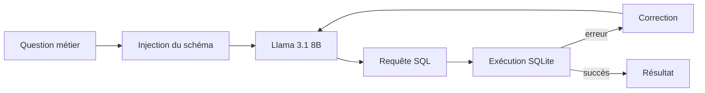

# Agent Text-to-SQL

Agent qui traduit des questions en langage métier en requêtes SQL, avec injection dynamique du schéma et boucle d'auto-correction sur les erreurs SQL. *Projet personnel en cours.*

## Fonctionnement



## Exemple

**Question :** « Quels sont les 3 clients avec les plus gros montants d'abonnements au sein de chaque région ? »

**Requête SQL générée :**

```sql
WITH Ranked AS (
    SELECT T3.region, T1.client_id,
           SUM(T1.prix_mensuel) AS total_abonnement,
           ROW_NUMBER() OVER (PARTITION BY T3.region
                              ORDER BY SUM(T1.prix_mensuel) DESC) AS rn
    FROM abonnements T1
    JOIN clients T2 ON T1.client_id = T2.client_id
    JOIN clients T3 ON T1.client_id = T3.client_id
    GROUP BY T3.region, T1.client_id
)
SELECT T2.nom_entreprise, T3.region, T1.total_abonnement
FROM Ranked T1
JOIN clients T2 ON T1.client_id = T2.client_id
JOIN clients T3 ON T1.client_id = T3.client_id
WHERE T1.rn <= 3;
```

**Résultat (extrait) :**

| Région | Client | Montant d'abonnement |
|---|---|---|
| Alsace | Collet S.A.R.L. | 537,79 € |
| Alsace | Hoareau | 500,67 € |
| Alsace | Rodriguez | 494,51 € |
| Aquitaine | Brunel Lenoir SARL | 593,80 € |
| Aquitaine | Jacob Aubry S.A. | 544,04 € |
| Aquitaine | Dubois SARL | 503,70 € |

*Base de démonstration avec des données fictives.*

## Exemple d'auto-correction

**Tentative 1** : l'agent génère une requête qui échoue :

```sql
WITH Ranked AS (
    SELECT region, client_id,
           SUM(prix_mensuel) AS total_abonnement,
           ROW_NUMBER() OVER (PARTITION BY region
                              ORDER BY SUM(prix_mensuel) DESC) AS rn
    FROM abonnements
    GROUP BY region, client_id
)
SELECT nom_entreprise, region, total_abonnement
FROM Ranked
JOIN clients ON Ranked.client_id = clients.client_id
WHERE rn <= 3;
```

**Erreur SQLite renvoyée à l'agent :**

```
sqlite3.OperationalError: no such column: region
```

**Tentative 2** : la colonne `region` appartient à la table `clients`, pas à `abonnements`. L'agent corrige en ajoutant la jointure nécessaire, et la requête s'exécute avec succès (voir la requête de l'exemple ci-dessus).

## Évaluation

Benchmark maison de questions métier en français, chacune associée à une requête SQL de référence : 491 exemples d'entraînement, 100 de validation et 100 de test, répartis en 12 familles (filtres, jointures, `GROUP BY` / `HAVING`, dates, top-N par groupe, ratios…). Le split test est réservé à l'évaluation finale.

**Métriques**

- **SQL valide** : la requête générée s'exécute sans erreur.
- **Execution accuracy (EX)**, métrique principale : la requête générée renvoie le même résultat que la référence. Les colonnes sont comparées à permutation près (convention de l'évaluateur [Spider test-suite](https://github.com/taoyds/test-suite-sql-eval)), et l'ordre des lignes ne compte que si la référence a un `ORDER BY`.
- **EX relâchée**, métrique secondaire : accepte aussi une requête qui renvoie la bonne réponse avec des colonnes en plus. Utile pour distinguer « mauvaise réponse » et « bonne réponse avec des colonnes en trop », mais gonflée par les `SELECT *` : elle ne sert pas à comparer deux prompts qui changent la façon de sélectionner les colonnes.

**Résultats** (Llama 3.1 8B Instruct, 0-shot, validation)

| Prompt | SQL valide | EX | EX relâchée |
|---|---|---|---|
| v1 : schéma seul | 87 % | 16 % | 34 % |
| v2 : + valeurs des colonnes catégorielles + règles SQLite | 90 % | 19 % | 25 % |

Chaque règle du prompt v2 vise une erreur observée sur la v1, et chacune a réduit son erreur cible : `SELECT *` passe de 27 à 10 requêtes, `EXTRACT` (absent de SQLite) et les valeurs mal casées (`'payée'` au lieu de `'Payée'`) disparaissent. Le gain d'EX (+3 points sur 100 questions) reste dans la marge de bruit. La baisse de l'EX relâchée s'explique par la disparition des `SELECT *` et par un modèle devenu trop minimaliste dans le choix des colonnes : c'est la cible de l'étape suivante, le few-shot.

Lancer un benchmark :

```bash
poetry run python -m src.text2sql.evaluate --split validation --shots 0 --name mon_run
```

Les sorties brutes du modèle, les requêtes et les scores par question sont enregistrés dans `results/`, avec les versions du prompt et de la métrique.

## Avancement

- [x] Agent LangChain/LCEL (Llama 3.1 8B)
- [x] Injection dynamique du schéma
- [x] Boucle d'auto-correction
- [x] Évaluation (execution accuracy, benchmark de 691 questions)
- [ ] Prompt few-shot
- [ ] Fine-tuning QLoRA
- [ ] Serving vLLM et suivi des performances


## Stack

Python · Llama 3.1 8B · LangChain (LCEL) · SQLite · Poetry